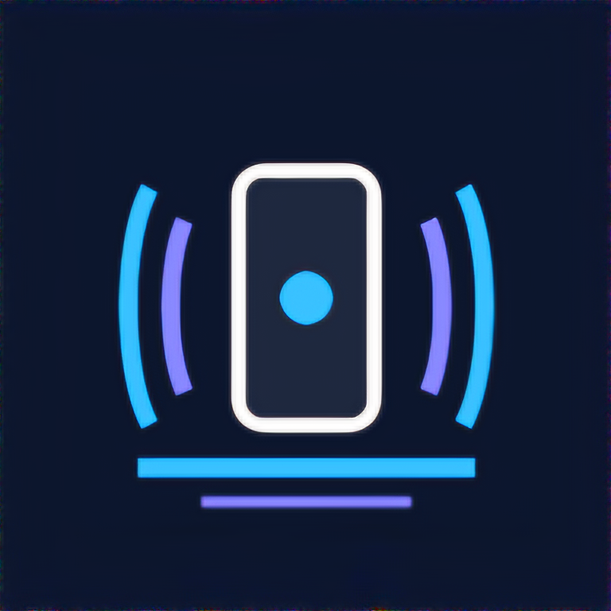
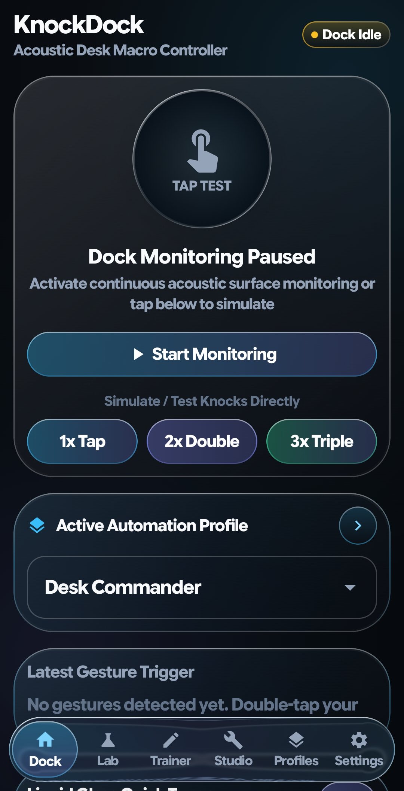
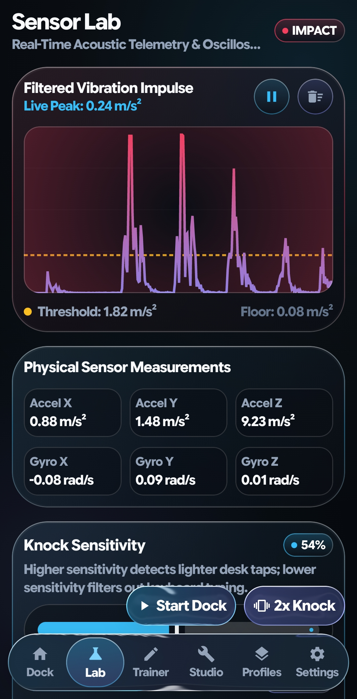
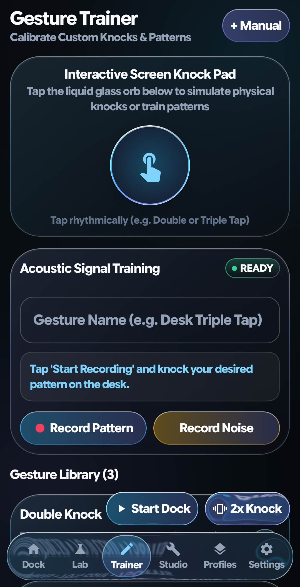
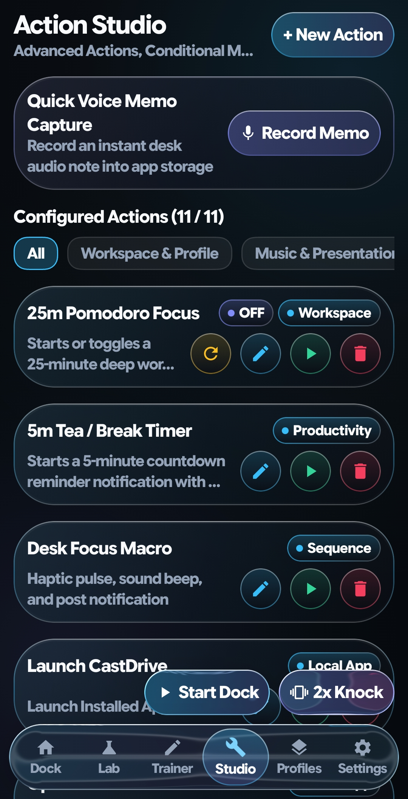
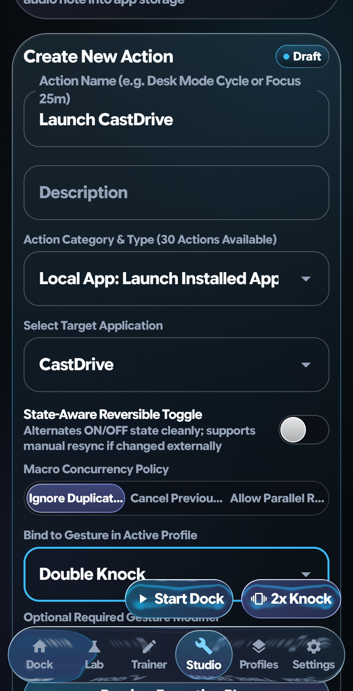
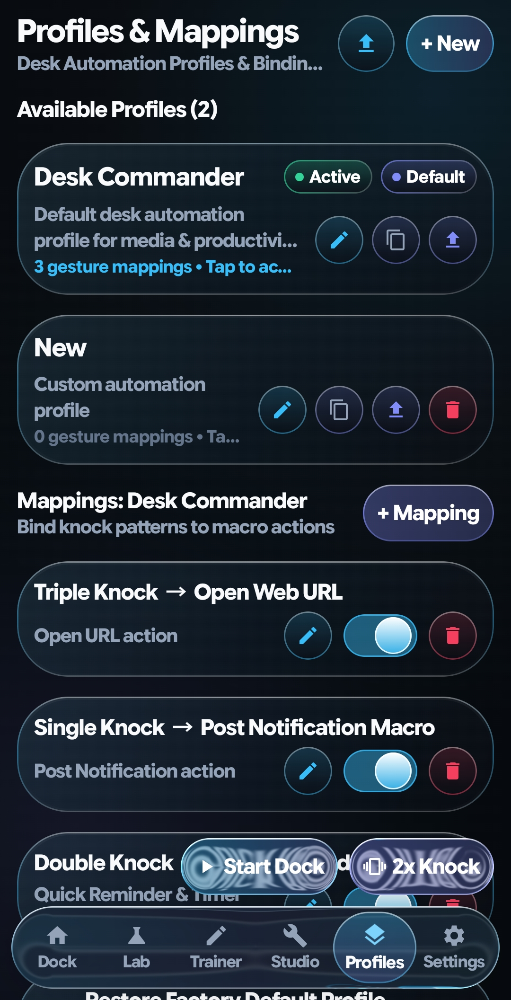

<div align="center">



# KnockDock

**Turn Physical Desk Knocks into Instant Android, Shizuku, Smart Home & PC Actions**

[](#releases)
[](#releases)
[](#releases)
[](#complete-feature-reference)
[](#9-kyant0-liquid-glass-optical-engine--settings-architecture)
[](#4-custom-action-studio-66-built-in--shizuku-actions)
[](https://github.com/RSR-Projects/KnockDock)

<br />

[](https://github.com/RSR-Projects/KnockDock/releases)
[](#screenshots--fastlane-visual-gallery)

</div>

---

## Overview

**KnockDock** transforms the physical surface of your desk into an acoustic and structural-vibration macro controller. Place your Android phone anywhere on your desk and knock, tap, or rap on the wood, glass, laminate, or metal surface to trigger:

- **66 Built-In Actions across 11 Specialized Categories**, including **30 Android, Smart Home & PC Actions** plus **36 `[Shizuku]` Privileged Actions** in Action Studio
- **4-Edge Perimeter Neon Lighting & Kyant0 Liquid Glass Knock HUD** that illuminates all 4 screen edges and displays the activated action inside the app, over the homescreen when closed, and on the lockscreen
- **Silent Work-Done Notification Logging** that records completed knock actions quietly in the status bar without intrusive popups or sounds
- **Acoustic Surface Resonator, FFT Spectrogram, Pocket/Tilt Auto-Guard & Morse Knock Cipher Pad** for real-time desk surface analysis and orientation protection
- **Multi-Step Conditional Macros** with dry-run simulation, cycle protection, step retries, and concurrency policies
- **Context Profiles & Gesture Modifier Chords** (`MOD_A`, `MOD_B`, `MOD_C`) that multiply your knock vocabulary
- **Background App & URL Launching** that works reliably even when KnockDock is minimized or closed
- **Authenticated Wi-Fi PC Control Bridge** for Windows/Mac virtual desktops, DAW transport, and presentation slides
- **Real-Time Kyant0 Liquid Glass UI** (`io.github.kyant0:backdrop` & `io.github.kyant0:shapes`) featuring an interactive squishy Liquid Glass bottom navigation dock (press-drag-release spring physics) and tactile squish animations across controls

---

## Releases


| Channel | Location | Description | Link |
| :--- | :--- | :--- | :--- |
| **GitHub Releases** | [`https://github.com/RSR-Projects/KnockDock/releases`](https://github.com/RSR-Projects/KnockDock/releases) | Official GitHub Releases page for signed APK downloads & changelogs | [**Open GitHub Releases**](https://github.com/RSR-Projects/KnockDock/releases) |

---

## Screenshots & Fastlane Visual Gallery


Screenshots are referenced strictly as `1.png`, `2.png`, `3.png`, `4.png`, `5.png`, and `6.png` under `fastlane/screenshots/` and `fastlane/metadata/android/en-US/images/phoneScreenshots/`.

| 1. Home Dock & Live Beacon (`1.png`) | 2. 60 FPS Sensor Lab & Oscilloscope (`2.png`) | 3. 3-Trial Gesture Trainer (`3.png`) |
| :---: | :---: | :---: |
| <a href="fastlane/screenshots/1.png"></a> | <a href="fastlane/screenshots/2.png"></a> | <a href="fastlane/screenshots/3.png"></a> |
| [`fastlane/screenshots/1.png`](fastlane/screenshots/1.png) · [Fastlane `1.png`](fastlane/metadata/android/en-US/images/phoneScreenshots/1.png) | [`fastlane/screenshots/2.png`](fastlane/screenshots/2.png) · [Fastlane `2.png`](fastlane/metadata/android/en-US/images/phoneScreenshots/2.png) | [`fastlane/screenshots/3.png`](fastlane/screenshots/3.png) · [Fastlane `3.png`](fastlane/metadata/android/en-US/images/phoneScreenshots/3.png) |

| 4. Custom Action Studio (`4.png`) | 5. Context Profiles & Chords (`5.png`) | 6. Collapsible Settings & About (`6.png`) |
| :---: | :---: | :---: |
| <a href="fastlane/screenshots/4.png"></a> | <a href="fastlane/screenshots/5.png"></a> | <a href="fastlane/screenshots/6.png"></a> |
| [`fastlane/screenshots/4.png`](fastlane/screenshots/4.png) · [Fastlane `4.png`](fastlane/metadata/android/en-US/images/phoneScreenshots/4.png) | [`fastlane/screenshots/5.png`](fastlane/screenshots/5.png) · [Fastlane `5.png`](fastlane/metadata/android/en-US/images/phoneScreenshots/5.png) | [`fastlane/screenshots/6.png`](fastlane/screenshots/6.png) · [Fastlane `6.png`](fastlane/metadata/android/en-US/images/phoneScreenshots/6.png) |

---

## Complete Feature Reference

### 1. Acoustic & Structural Vibration Detection Engine


-10B981?style=plastic&labelColor=0B132B)


- **6-Axis Sensor Fusion (`SensorManagerHelper.kt` & `VibrationFilter.kt`)**:
  - Combines 3-axis `TYPE_ACCELEROMETER` and 3-axis `TYPE_GYROSCOPE` streams in real time.
  - Applies a first-order **High-Pass Filter (HPF)** ($\alpha = 0.80$) to strip static gravity ($9.81\text{ m/s}^2$) and slow tilt while isolating sharp z-axis structural knock impulses.
- **Dynamic Exponential Moving Average (EMA) Noise Floor (`ImpactDetector.kt`)**:
  - Continuously tracks ambient room/desk vibration (typing, fan hum, speakers) and computes an adaptive trigger threshold:
    $$\text{Effective Threshold} = (\text{NoiseFloor} \times 1.5) + (\text{BaseThreshold} \times (1.1 - 0.75 \times \text{Sensitivity}))$$
- **Hand-Holding & Tilt Rejection with Camera-Bump Micro-Rocking Tolerance**:
  - Tracks a low-pass 3D gravity vector (`gravityAlpha = 0.03`, frozen during sharp impulse spikes so knocks never corrupt orientation) alongside a smoothed gyroscope angular velocity baseline (`smoothedGyroVel` EMA).
  - Automatically rejects false triggers when the phone is held at an angle in hand (`tiltAngleDegrees > 30°`), actively rotated (`gyroAngularVelocity > 1.35 rad/s`), or continuously carried (`smoothedGyroVel > 0.65 rad/s`).
  - Permits brief camera-bump micro-rocking on hard desks and uses an `80 ms` refractory dead-time window so rapid **Single, Double, Triple, Quadruple, and Rhythm Knocks** register reliably without echo splitting.
- **Smart Pocket & Tilt Auto-Guard**:
  - Monitors 3D gravity orientation (pitch and roll degrees from flat) alongside gyroscope angular velocity (`rad/s`) in the Acoustic Lab to automatically disarm knock triggers when tilted or pocketed and re-arm when placed flat on a desk.
- **Acoustic Surface Resonator & FFT Spectrogram**:
  - Analyzes resonant frequency bars (`50 Hz – 800 Hz`) and damping decay time (`ms`) on knock impacts to classify desk material (*Dense Hardwood*, *Tempered Glass*, *Hollow Core*, or *Damped Mat*) with 1-tap optimal DSP auto-tuning.
- **Morse & Rhythm Knock Cipher Pad**:
  - Decodes inter-knock intervals into Short (`•`) and Long (`—`) rhythm symbols in real time (`••`, `•••`, `•—•`, `•••———•••`, `—•—•`) with instant test-knock injection.

---

### 2. 4-Edge Perimeter Neon Lighting, Kyant0 Liquid Glass Knock HUD & Silent Notifications


-10B981?style=plastic&labelColor=0B132B)

- **Full 4-Edge Perimeter Neon Lighting (`KnockEdgeAndHudOverlay.kt` & `SystemEdgeLightingOverlayManager.kt`)**:
  - Sweeps a glowing multi-stop neon gradient along all 4 edges and rounded corners of the phone display whenever a knock gesture is recognized.
  - Operates inside the app, over the Android homescreen or other apps when KnockDock is closed (via hardware-accelerated `TYPE_APPLICATION_OVERLAY`), and on the lockscreen.
- **100% Non-Blocking Touch Pass-Through Overlay Architecture**:
  - Uses `FLAG_NOT_FOCUSABLE | FLAG_NOT_TOUCHABLE | FLAG_NOT_TOUCH_MODAL` combined with Android 12+ (`API 31+`) `InputManager.maximumObscuringOpacityForTouch` compliance (`params.alpha <= 0.76f`) so the system never blocks or intercepts touches, swipes, or typing in underlying apps, plus a `1.3s` hardware watchdog auto-detach timer.
- **Kyant0 Liquid Glass Action Activated Banner (`LiquidMacroDoneHudBanner`)**:
  - Displays a real-time Kyant0 `drawBackdrop` Liquid Glass capsule (`vibrancy()`, `blur()`, `lens()` refraction, `Highlight.Default`) showing which knock gesture was detected and which action was activated.
- **Silent Work-Done Status Notification**:
  - Posts a quiet, low-priority notification to the status bar (`IMPORTANCE_LOW`, zero sound, zero heads-up interruption) summarizing completed knock actions.
- **Interactive Onboarding & Permissions Tutorial Deck**:
  - Guided 4-step Liquid Glass tutorial and live permission status checklist (*Notifications*, *Appear on Top*, *Battery Optimization Exemption*, and *Do Not Disturb Access*) accessible on first launch or anytime from the Home header.

---

### 3. Real-Time Sensor Lab & 60 FPS Oscilloscope


- **Live High-Pass Impulse Waveform**:
  - Hardware-accelerated Canvas oscilloscope plotting real-time filtered impulse magnitude against the live adaptive threshold line.
  - Supports **Pause / Resume Freeze-Frame** and **Peak-Hold Capture** to inspect exact impulse amplitudes.
- **6-Axis Telemetry Cards**:
  - Displays live `Accel X`, `Accel Y`, `Accel Z`, `Filtered Impulse`, `Dynamic Noise Floor`, and `Gyroscope Magnitude` in spacious, non-clipping cards.
- **Synthetic Signal Replayer (`SensorReplayer.kt`)**:
  - Injects deterministic sensor waveforms directly into the live detection pipeline (`Single Knock`, `Double Knock`, `Triple Knock`, `Quadruple Knock`, and `Rap-Pause-Rap`) so you can verify gestures and macros without physically tapping.

---

### 4. Multi-Trial Gesture Recognition & Gesture Trainer


- **Temporal Pattern Classifier (`GestureRecognizer.kt`)**:
  - Segments impact sequences when quiet time exceeds the sequence timeout window (`520 ms`).
  - Scores candidate gestures by matching **impact count**, **inter-knock interval bounds** (`minIntervalMs` .. `maxIntervalMs`), **rhythm ratio**, and **impulse confidence**, selecting the highest-confidence match above `minConfidence`.
- **Interactive 3-Trial Gesture Trainer**:
  - Guides you through recording a custom knock pattern **3 times in a row**.
  - Validates that all 3 trials have matching impact counts, computes the **Consistency Score (0–100%)**, and automatically derives optimal `minIntervalMs` and `maxIntervalMs` tolerances.
- **Direct Manual Gesture Creator & Editor**:
  - Create or edit any gesture directly via sliders for **Impact Count (1–6)**, **Min Interval (50–800 ms)**, **Max Interval (120–1500 ms)**, **Min Confidence (30–95%)**, and **Cooldown (200–3000 ms)**.

---

### 5. Custom Action Studio (66 Built-In & `[Shizuku]` Actions)

-00E5FF?style=plastic&labelColor=0B132B)


Every action in Action Studio includes a dedicated configuration UI, real-time parameter validation, a **Dry-Run Simulation** mode, a **Live Test** button, and structured execution logs.

#### A. Workspace & Profile Actions
1. **Desk Mode Toggle (`DESK_MODE_TOGGLE`)**: Alternates between a Primary Profile and Secondary Profile (e.g., *Work* ↔ *Gaming*), optionally firing an activation action while preventing recursive profile-switching loops.
2. **Focus Session Controller (`FOCUS_SESSION_CONTROLLER`)**: Starts, pauses, resumes, toggles, or ends a timed Pomodoro/Focus session (`durationMinutes`, `breakMinutes`) with optional automatic **Do Not Disturb (DND)** management.
3. **Workspace Switcher (`WORKSPACE_SWITCHER`)** *(PC Bridge)*: Sends authenticated workspace commands to a paired Windows/Mac PC (`virtual_desktop_next`, `virtual_desktop_prev`, `minimize_all`, `restore_windows`, `launch_workspace_set`).
4. **Switch Profile (`SWITCH_PROFILE`)**: Directly activates a target `DockProfile` and applies its sensitivity and gesture mappings.

#### B. Music, Media & Presentation Actions
5. **Music & DAW Session Controller (`MUSIC_SESSION_CONTROLLER`)**: Controls Android media playback (`PLAY_PAUSE`, `NEXT`, `PREVIOUS`, `STOP`), launches a target music app or playlist deep link, and dispatches authenticated DAW transport commands (`daw_play`, `daw_stop`, `daw_record`, `daw_metronome`, `daw_next_marker`, `daw_prev_marker`) to a paired PC.
6. **Presentation Remote (`PRESENTATION_REMOTE`)** *(PC Bridge)*: Advances or reverses slides (`next_slide`, `previous_slide`, `start_presentation`, `end_presentation`, `blackout_screen`) on a paired PC.
7. **Gesture Modifier (`GESTURE_MODIFIER`)**: Activates a temporary modifier chord (`MOD_A`, `MOD_B`, or `MOD_C`) for a configurable countdown window (`1500 ms – 10000 ms`, default `4000 ms`).
8. **Playlist / Station Launcher (`PLAYLIST_STATION_LAUNCHER`)**: Opens a configured Spotify, YouTube Music, or custom deep link URI.
9. **Media Play / Pause (`MEDIA_PLAY_PAUSE`)**: Dispatches hardware `KEYCODE_MEDIA_PLAY_PAUSE` via Android `AudioManager`.
10. **Media Next Track (`MEDIA_NEXT`)**: Dispatches `KEYCODE_MEDIA_NEXT` to skip to the next track.
11. **Media Previous Track (`MEDIA_PREVIOUS`)**: Dispatches `KEYCODE_MEDIA_PREVIOUS` to return to the previous track.

#### C. Productivity & Capture Actions
12. **Snippet & Clipboard Launcher (`SNIPPET_LAUNCHER`)**: Copies a multi-line text template to the Android clipboard (`COPY_CLIPBOARD`), opens the Android Share Sheet (`SHARE_SHEET`), or displays a quick overlay card.
13. **Screenshot & Annotation Workflow (`SCREENSHOT_ANNOTATION_LAUNCHER`)**: Triggers an Android capture/share workflow (`ANDROID_CAPTURE_SHEET`, `OPEN_GALLERY_LATEST`, or paired PC `PC_SCREENSHOT_ANNOTATE`).
14. **Quick Reminder & Countdown Timer (`QUICK_REMINDER_TIMER`)**: Starts an in-app and notification countdown timer (`1m`, `5m`, `10m`, `15m`, `30m`, or custom seconds) with snooze and dismiss controls.
15. **Quick Voice Memo (`QUICK_VOICE_MEMO`)**: Records an AAC/M4A voice note (`5s – 300s`) using `MediaRecorder` into app storage with runtime `RECORD_AUDIO` permission handling.
16. **Quick Tool Launcher (`QUICK_TOOL_LAUNCHER`)**: Launches everyday desk utilities (`CALCULATOR`, `CLOCK_ALARM`, `CALENDAR`, `NOTES`, `CAMERA`, or a custom package fallback).

#### D. Smart Home, Network & Connected Actions
17. **Smart Home Scene Trigger (`SMART_HOME_SCENE_TRIGGER`)**: Triggers a Home Assistant, webhook, or local IoT scene payload with configurable endpoint URL, method, and JSON payload.
18. **Local Webhook / HTTP Request (`WEBHOOK_HTTP_TRIGGER`)**: Executes real `GET`, `POST`, or `PUT` HTTP requests with custom JSON headers, payload body, and timeout (`1000 ms – 15000 ms`).
19. **PC Command Bridge (`PC_COMMAND`)** *(PC Bridge)*: Sends low-latency JSON commands (`lock_workstation`, `mute_mic`, `play_pause`, `screenshot`, `open_terminal`, etc.) over LAN to the companion PC server.

#### E. Multi-Step Macro & Sequence Engine
20. **Action Sequence / Conditional Macro (`MULTI_STEP_SEQUENCE`)**: Runs an ordered list of steps (`ActionType` + `DelayMs` + `StepCondition` + `RetryCount` + `FailurePolicy`) with full dry-run support and cycle detection.

#### F. Device & Utility Actions
21. **Launch App (`LAUNCH_APP`)**: Opens any installed launchable Android application by package name, including from background monitoring.
22. **Launch URL / Deep Link (`LAUNCH_URL`)**: Opens any web URL or custom scheme URI in the default browser or handler app.
23. **Flashlight / Torch Toggle (`TOGGLE_FLASHLIGHT`)**: Toggles the rear camera LED torch via `CameraManager`.
24. **Emergency Alert Beacon (`EMERGENCY_LIGHT_SEQUENCE`)**: Activates the camera torch SOS/strobe sequence and high-visibility screen beacon with an immediate stop control.
25. **Device Finder Alert (`DEVICE_FINDER_ALERT`)**: Plays an acoustic locator siren chirp and pulses haptics so you can find your phone on a cluttered desk.
26. **Ringer Mode Cycle (`RINGER_MODE_CYCLE`)**: Cycles or sets Android `AudioManager` ringer state (`NORMAL`, `VIBRATE`, `SILENT`).
27. **Volume Step Up / Down / Mute (`VOLUME_UP`, `VOLUME_DOWN`, `MUTE_TOGGLE`)**: Adjusts media or ring stream volume.
28. **System Settings Panel (`SYSTEM_SETTING`)**: Opens Android system settings (`SOUND`, `WIFI`, `BLUETOOTH`, `DISPLAY`, `DND`, `BATTERY`, `OVERLAY`).
29. **Custom Notification (`NOTIFICATION`)**, **Haptic Pulse (`HAPTIC_PULSE`)**, and **Acoustic Synth Chirp (`AUDIO_CHIRP`)**: Fires status notifications, tactile vibration patterns, or synthesized sine-wave audio chirps.
30. **Toggle Monitoring (`TOGGLE_MONITORING`)**: Pauses or resumes live knock detection.

#### G. 36 `[Shizuku]` Privileged Actions in Action Studio (`SHIZUKU_PRIVILEGED`)
All 36 `[Shizuku]` actions are available exclusively inside the **Action Studio** tab (both in the Studio action list under the `"Shizuku Privileged"` filter and inside `+ New Action`). Connection status is strictly verified against the live `Shizuku.pingBinder()` service and `Shizuku.checkSelfPermission()`, so it reports **Connected** only when Shizuku is genuinely installed, running, and authorized:

1. **`[Shizuku] Expand Notifications Shade`** (`cmd statusbar expand-notifications`)
2. **`[Shizuku] Expand Quick Settings Panel`** (`cmd statusbar expand-settings`)
3. **`[Shizuku] Collapse Status Bar Panels`** (`cmd statusbar collapse`)
4. **`[Shizuku] Immersive Fullscreen Toggle`** (`settings put global policy_control immersive.full=*`)
5. **`[Shizuku] Status Bar Clock Seconds Toggle`** (`settings put secure clock_seconds 1/0`)
6. **`[Shizuku] Status Bar Battery Percentage Toggle`** (`settings put system status_bar_show_battery_percent 1/0`)
7. **`[Shizuku] Heads-Up Peeking Notifications Toggle`** (`settings put global heads_up_notifications_enabled 0/1`)
8. **`[Shizuku] Lock Rotation to Portrait (0°)`** (`wm user-rotation lock 0`)
9. **`[Shizuku] Lock Rotation to Landscape (90°)`** (`wm user-rotation lock 1`)
10. **`[Shizuku] Force Peak 120Hz Smooth Refresh`** (`settings put system peak_refresh_rate 120.0`)
11. **`[Shizuku] Battery-Saver 60Hz Refresh Cap`** (`settings put system peak_refresh_rate 60.0`)
12. **`[Shizuku] Extra-Dim Night Reading Filter`** (`settings put secure reduce_bright_colors_activated 1/0`)
13. **`[Shizuku] Grayscale Monochrome Focus Mode`** (`secure accessibility_display_daltonizer_enabled 1/0`)
14. **`[Shizuku] Night Light Warm Amber Shield`** (`settings put secure night_display_activated 1/0`)
15. **`[Shizuku] Visual Touch Taps Indicator`** (`settings put system show_touches 1/0`)
16. **`[Shizuku] High-Contrast Pointer Coordinates Overlay`** (`settings put system pointer_location 1/0`)
17. **`[Shizuku] Adaptive Auto-Brightness Toggle`** (`settings put system screen_brightness_mode 1/0`)
18. **`[Shizuku] Instant Lossless PNG Screenshot`** (`screencap -p /sdcard/Pictures/KnockDock_Shot.png`)
19. **`[Shizuku] Instant Screen Sleep (Keycode Sleep)`** (`input keyevent 223`)
20. **`[Shizuku] Wake Display & Show Lockscreen`** (`input keyevent 224`)
21. **`[Shizuku] Trigger Recent Apps Overview`** (`input keyevent 187`)
22. **`[Shizuku] Split-Screen Multi-Window Dock`** (`input keyevent 285`)
23. **`[Shizuku] Trigger System Assistant Overlay`** (`input keyevent 219`)
24. **`[Shizuku] Toggle Camera Mute / Privacy Sensor`** (`cmd sensor_privacy enable/disable camera`)
25. **`[Shizuku] Wi-Fi Radio Direct Toggle`** (`svc wifi disable/enable`)
26. **`[Shizuku] Bluetooth Radio Direct Toggle`** (`svc bluetooth disable/enable`)
27. **`[Shizuku] Mobile Data Cellular Toggle`** (`svc data disable/enable`)
28. **`[Shizuku] NFC Contactless Radio Toggle`** (`svc nfc disable/enable`)
29. **`[Shizuku] USB Stay-Awake While Charging`** (`svc power stayon usb/false`)
30. **`[Shizuku] Ultra-Snappy 0.5x Animator Speed`** (`settings put global animator_duration_scale 0.5`)
31. **`[Shizuku] Zero-Latency 0.0x Instant Animations`** (`settings put global window_animation_scale 0.0`)
32. **`[Shizuku] Trim Background App Caches (RAM Boost)`** (`pm trim-caches 4G`)
33. **`[Shizuku] Force-Idle Doze Battery Optimization`** (`dumpsys deviceidle force-idle`)
34. **`[Shizuku] Self-Grant KnockDock Background Permissions`** (`appops set {{PACKAGE}} SYSTEM_ALERT_WINDOW allow`)
35. **`[Shizuku] Dump Thermal & Battery Health Snapshot`** (`dumpsys battery`)
36. **`[Shizuku] Audit Top CPU & Memory Processes`** (`top -n 1 -m 5`)

---

### 6. Multi-Step Conditional Macro Engine & Dry-Run Simulator


-10B981?style=plastic&labelColor=0B132B)

- **Per-Step Conditions (`StepConditionType`)**:
  - `NONE`, `PREVIOUS_STEP_SUCCESS`, `FOCUS_SESSION_ACTIVE`, `PC_PAIRED`, `ACTIVE_PROFILE_IS`, `CHARGING_STATE_IS`, `TIME_WINDOW`, and `DND_PERMISSION_GRANTED`.
- **Failure & Retry Policies (`StepFailurePolicy`)**:
  - Each step supports `0–5` automatic retries plus `STOP_MACRO`, `CONTINUE`, or `RETRY_THEN_CONTINUE` failure handling.
- **Concurrency Policies (`MacroConcurrencyPolicy`)**:
  - Choose how overlapping triggers behave: `SKIP_IF_RUNNING`, `RESTART_LATEST`, or `ALLOW_PARALLEL`.
- **Guaranteed Side-Effect-Free Dry-Run**:
  - Validates every parameter, branch condition, nested sequence, and target reference without launching apps, toggling hardware torches, altering DND/ringer state, sending network webhooks, recording audio, or mutating profile state.

---

### 7. Context Profiles, Gesture Chords & JSON Backup/Restore


- **Context Profiles (`DockProfile`)**:
  - Switch between *Desk Commander*, *Focus Guard*, *Media Deck*, or custom profiles. Each profile stores its own sensitivity multiplier, sampling rate, and gesture-to-action mappings.
- **Modifier Chord Support**:
  - Bind the same physical gesture (e.g., *Double Knock*) to different actions depending on whether `No Modifier`, `MOD_A`, `MOD_B`, or `MOD_C` is currently active.
- **Conflict Detector & JSON Import/Export**:
  - Automatically scans the active profile for overlapping interval windows or duplicate gesture+modifier bindings, and exports/imports full JSON configurations.

---

### 8. Background Monitoring & Closed-App Execution Bridge


- **Persistent Foreground Service (`KnockMonitoringService.kt`)**:
  - Runs with `START_STICKY`, a dedicated persistent notification, and a partial CPU `WakeLock` (`KnockDock::SensorMonitoringWakeLock`) so desk knocks are detected even when the screen is off or the app is swiped away.
- **Android 10+ Background App & URL Launch Bridge**:
  - Combines direct `FLAG_ACTIVITY_NEW_TASK` intent dispatch, a transient `TYPE_APPLICATION_OVERLAY` window bridge (when *"Appear on Top"* is granted), and a high-priority full-screen `PendingIntent` fallback so launching apps, URLs, playlists, and system panels works reliably from the background.

---

### 9. Kyant0 Liquid Glass Optical Engine & Settings Architecture


- **Real-Time Kyant0 Backdrop Optical Engine (`LiquidGlass.kt` & `LiquidGlassComponents.kt`)**:
  - Powered by [`Kyant0/AndroidLiquidGlass`](https://github.com/Kyant0/AndroidLiquidGlass) (`io.github.kyant0:backdrop:1.0.6` and `io.github.kyant0:shapes:1.2.0`) with `rememberLayerBackdrop()`, real-time GPU blur (`blur()`), lens refraction (`lens()`), chromatic dispersion (`chromaticAberration`), vibrancy, and `RoundedRectangle` continuous capsule geometry.
- **Interactive Squishy Liquid Glass Bottom Navigation Dock**:
  - Press-hold-drag horizontal tracking with velocity-driven liquid stretch (`scaleX` / `scaleY`), vertical dock expansion while dragging, chromatic aberration lens refraction, and release-to-commit tab switching.
- **Tactile Liquid Squish Controls & Uncramped Responsive Layouts**:
  - All interactive buttons (`LiquidGlowButton`, `LiquidGlassIconButton`), switches (`LiquidGlassSwitch`), sliders (`LiquidGlassSlider`), and horizontally scrollable segmented rows (`LiquidGlassSegmentedRow`) feature smooth spring-based `liquidSquish` feedback with generous pill spacing so labels never wrap character-by-character.
- **Collapsible Settings & About Folders (`SettingsScreen.kt` & `AboutSettingsSection.kt`)**:
  - Organized into collapsible folders that start closed by default:
    - **Background Launch & Power**
    - **Card Liquid Glass & Bottom Nav Bar Glass**
    - **Liquid Touch Physics**
    - **Sensor & Knock Detection**
    - **Haptics, Audio & Visual Knock Effects** (4-Edge Neon Lighting, Liquid Glass Knock HUD, Silent Completion Notification, Interactive Tutorial)
    - **Shizuku Permission**
    - **PC Control Bridge (Wi-Fi)**
    - **System Diagnostics & Hardware Audit**
    - **About KnockDock, Developer & Licence, GitHub Links, Privacy & Build Info**

---

## Fastlane Directory & Store Metadata

```text
fastlane/
├── Appfile                                          # Package ID: com.rsrprojects.knockdock
├── Fastfile                                         # Lanes: test, build_debug, build_release, internal, deploy
├── screenshots/                                     # Phone Screenshots directory (1.png .. 6.png)
│   └── .gitkeep
└── metadata/
    └── android/
        └── en-US/
            ├── title.txt                            # "KnockDock"
            ├── short_description.txt                # 80-char Play Store short summary
            ├── full_description.txt                 # Full Play Store listing description
            ├── changelogs/
            │   ├── default.txt
            │   └── 1.txt
            └── images/
                ├── .gitkeep
                └── phoneScreenshots/                # Fastlane Phone Screenshots (1.png .. 6.png)
                    └── .gitkeep
```

---

## Building, Signing & Running Tests

-00E5FF?style=plastic&labelColor=0B132B&logo=gradle&logoColor=00E5FF)
-10B981?style=plastic&labelColor=0B132B)

```bash
# Verify Gradle Wrapper
./gradlew --version

# Run unit & regression test suites
./gradlew :app:testDebugUnitTest

# Build signed Release APK using the included upload keystore
KEYSTORE_PATH="$(pwd)/my-upload-key.jks" \
STORE_PASSWORD="android" \
KEY_PASSWORD="android" \
./gradlew :app:assembleRelease
```
