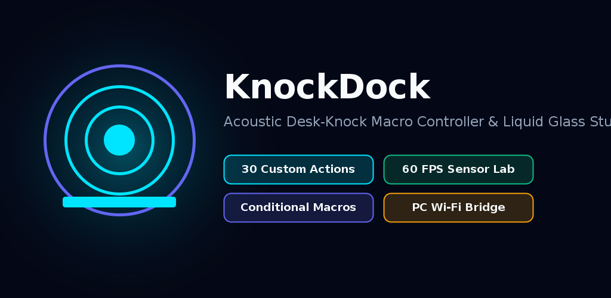

<div align="center">


# KnockDock

**Acoustic Desk-Surface Knock & Vibration Macro Controller for Android & Windows PC**

[-00E5FF?style=for-the-badge&logo=android&logoColor=white)](#)
[](#)
[](#)
[](#10-liquid-glass-optical-engine--elastic-squish-physics)
[](#4-custom-action-studio-all-30-actions-explained)
[](#12-fastlane-directory--store-metadata)

<br />


[](../../releases/latest)
[](#screenshots--fastlane-visual-gallery)

<br />



</div>

---

## Overview

**KnockDock** turns the physical surface of your desk into an intelligent acoustic and structural-vibration macro controller. Place your Android device anywhere on your desk and knock, tap, or rap on the wood, glass, laminate, or metal surface to trigger:

- **30 Built-In Android, Smart Home & PC Actions** across 10 specialized categories
- **Multi-Step Conditional Macros** with dry-run simulation, cycle protection, step retries, and concurrency policies
- **Context Profiles & Gesture Modifier Chords** (`MOD_A`, `MOD_B`, `MOD_C`) that multiply your knock vocabulary
- **Background App & URL Launching** that works even when KnockDock is minimized or closed
- **Authenticated Wi-Fi PC Control Bridge** 
- **Pure Dark-Mode Liquid Glass UI** with independent optical controls for Cards vs. Floating Bottom Navigation Bar and long, fast, spring-physics touch squish animations

---

## Releases & Download

-00E5FF?style=flat-square)

-6366F1?style=flat-square)
-F59E0B?style=flat-square)

### Direct Download Options
)
| **Gradle Output APK** | [`app/build/outputs/apk/debug/app-debug.apk`](./app/build/outputs/apk/debug/app-debug.apk) | Standard Gradle build artifact path | [**Download Gradle APK**](./app/build/outputs/apk/debug/app-debug.apk) |
| **GitHub Releases** | [`/releases/latest`](../../releases/latest) | Official tagged releases and changelogs | [**Open Releases Page**](../../releases/latest) |


---

## Screenshots & Fastlane Visual Gallery


All screenshots and store graphics are stored in both standard Fastlane paths (`fastlane/metadata/android/en-US/images/...`) and convenience paths (`fastlane/screenshots/...` & `fastlane/icon.png`).

| 1. Home Dock & Live Beacon | 2. 60 FPS Sensor Lab & Oscilloscope | 3. 3-Trial Gesture Trainer |
| :---: | :---: | :---: |
| <a href="fastlane/screenshots/1_dock_home.png"></a> | <a href="fastlane/screenshots/2_sensor_lab.png"></a> | <a href="fastlane/screenshots/3_gesture_trainer.png"></a> |
| [View Full Size (`fastlane/screenshots/1.png`)](fastlane/screenshots/1.png) · [Fastlane Path](fastlane/metadata/android/en-US/images/phoneScreenshots/1.png) | [View Full Size (`fastlane/screenshots/2.png`)](fastlane/screenshots/2.png) · [Fastlane Path](fastlane/metadata/android/en-US/images/phoneScreenshots/2.png) | [View Full Size (`fastlane/screenshots/3.png`)](fastlane/screenshots/3.png) · [Fastlane Path](fastlane/metadata/android/en-US/images/phoneScreenshots/3.png) |

| 4. Custom Action Studio (30 Actions) | 5. Context Profiles & Modifier Chords | 6. Folder-Categorized Settings & Glass |
| :---: | :---: | :---: |
| <a href="fastlane/screenshots/4_action_studio.png"></a> | <a href="fastlane/screenshots/5_profiles_mappings.png"></a> | <a href="fastlane/screenshots/6_settings_folders.png"></a> |
| [View Full Size (`fastlane/screenshots/4.png`)](fastlane/screenshots/4.png) · [Fastlane Path](fastlane/metadata/android/en-US/images/phoneScreenshots/4.png) | [View Full Size (`fastlane/screenshots/5.png`)](fastlane/screenshots/5.png) · [Fastlane Path](fastlane/metadata/android/en-US/images/phoneScreenshots/5.png) | [View Full Size (`fastlane/screenshots/6.png`)](fastlane/screenshots/6.png) · [Fastlane Path](fastlane/metadata/android/en-US/images/phoneScreenshots/6.png) |

---

## Complete Feature Reference

### 1. Acoustic & Structural Vibration Detection Engine


-10B981?style=flat-square)


- **6-Axis Sensor Fusion (`SensorHelper.kt` & `SignalFilter.kt`)**:
  - Combines 3-axis `TYPE_ACCELEROMETER` and 3-axis `TYPE_GYROSCOPE` streams at high speed.
  - Applies a first-order **High-Pass Filter (HPF)** ($\alpha = 0.82$) to strip static gravity ($9.81\text{ m/s}^2$) and slow desk tilt while isolating sharp z-axis structural knock impulses.
- **Dynamic Exponential Moving Average (EMA) Noise Floor (`ImpactDetector.kt`)**:
  - Continuously tracks ambient room/desk vibration (typing, fan hum, music speakers) and computes an adaptive trigger threshold:
    $$\text{Effective Threshold} = \frac{\text{BaseThreshold} + (\text{NoiseFloor} \times 2.6)}{\text{SensitivityMultiplier} \times \text{SurfaceGain}}$$
- **Refractory Window & Structural Ringing Suppression**:
  - Enforces a configurable refractory cooldown (`65 ms – 220 ms`, default `95 ms`) after each detected impact so resonant wood/glass after-vibrations are never double-counted as extra knocks.
- **Device-Handling & Pick-Up Rejection**:
  - Monitors gyroscope angular velocity magnitude (`rad/s`) and suppresses false knock triggers when the phone is being picked up, tilted, or carried in hand.
- **Desk Surface Material Presets**:
  - Dedicated acoustic gain and damping presets for **Wood Desk**, **Glass Table**, **Metal / Standing Desk**, and **Soft / Mat Surface**.

---

### 2. Real-Time Sensor Lab & 60 FPS Oscilloscope


- **Live High-Pass Impulse Waveform**:
  - Hardware-accelerated Canvas oscilloscope plotting real-time filtered impulse magnitude against the live adaptive threshold line.
  - Supports **Pause / Resume Freeze-Frame** and **Peak-Hold Capture** to inspect exact impulse amplitudes.
- **6-Axis Telemetry Cards**:
  - Displays live `Accel X`, `Accel Y`, `Accel Z`, `Filtered Impulse`, `Dynamic Noise Floor`, and `Gyroscope Magnitude` in compact, non-clipping cards.
- **Synthetic Signal Replayer (`SensorReplayer.kt`)**:
  - Injects deterministic sensor waveforms directly into the live detection pipeline (`Single Knock`, `Double Knock`, `Triple Knock`, `Quadruple Knock`, and `Rap-Pause-Rap`) so you can verify gestures and macros without physically tapping.

---

### 3. Multi-Trial Gesture Recognition & Gesture Trainer


- **Temporal Pattern Classifier (`GestureClassifier.kt`)**:
  - Segments impact sequences when quiet time exceeds the sequence timeout window (`520 ms`).
  - Scores candidate gestures by matching **impact count**, **inter-knock interval bounds** (`minIntervalMs` .. `maxIntervalMs`), **rhythm ratio**, and **impulse confidence**, selecting the highest-confidence match above `minConfidence`.
- **Interactive 3-Trial Gesture Trainer (`GestureTrainer.kt`)**:
  - Guides you through recording a custom knock pattern **3 times in a row**.
  - Validates that all 3 trials have matching impact counts, computes the **Consistency Score (0–100%)**, and automatically derives optimal `minIntervalMs` and `maxIntervalMs` tolerances.
- **Direct Manual Gesture Creator & Editor**:
  - Create or edit any gesture directly via sliders for **Impact Count (1–6)**, **Min Interval (50–800 ms)**, **Max Interval (120–1500 ms)**, **Min Confidence (30–95%)**, and **Cooldown (200–3000 ms)**.

---

### 4. Custom Action Studio (All 30 Actions Explained)


Every action in KnockDock includes a dedicated configuration UI, real-time parameter validation, a **Dry-Run Simulation** button (validates without executing real side effects), a **Live Test** button, and structured execution logs.

#### A. Workspace & Profile Actions
1. **Desk Mode Toggle (`DESK_MODE_TOGGLE`)**:
   - Alternates between a Primary Profile and Secondary Profile (e.g., *Work* ↔ *Gaming*), optionally firing an activation action while preventing recursive profile-switching loops.
2. **Focus Session Controller (`FOCUS_SESSION_CONTROLLER`)**:
   - Starts, pauses, resumes, toggles, or ends a timed Pomodoro/Focus session (`durationMinutes`, `breakMinutes`).
   - Optionally enables Android **Do Not Disturb (DND)** when permission is granted and **automatically restores** the prior interruption filter when the session ends (unless the user manually changed DND in the meantime).
3. **Workspace Switcher (`WORKSPACE_SWITCHER`)** *(PC Bridge)*:
   - Sends authenticated workspace commands to a paired Windows/Mac PC (`virtual_desktop_next`, `virtual_desktop_prev`, `minimize_all`, `restore_windows`, `launch_workspace_set`).
4. **Switch Profile (`SWITCH_PROFILE`)**:
   - Directly activates a target `DockProfile` and applies its sensitivity and gesture mappings.

#### B. Music, Media & Presentation Actions
5. **Music & DAW Session Controller (`MUSIC_SESSION_CONTROLLER`)**:
   - Controls Android media playback (`PLAY_PAUSE`, `NEXT`, `PREVIOUS`, `STOP`), launches a target music app or playlist deep link, and optionally dispatches authenticated DAW transport commands (`daw_play`, `daw_stop`, `daw_record`, `daw_metronome`, `daw_next_marker`, `daw_prev_marker`) to a paired PC.
6. **Presentation Remote (`PRESENTATION_REMOTE`)** *(PC Bridge)*:
   - Advances or reverses slides (`next_slide`, `previous_slide`, `start_presentation`, `end_presentation`, `blackout_screen`) on a paired PC with connection status and test verification.
7. **Gesture Modifier (`GESTURE_MODIFIER`)**:
   - Activates a temporary modifier chord (`MOD_A`, `MOD_B`, or `MOD_C`) for a configurable countdown window (`1500 ms – 10000 ms`, default `4000 ms`) so the next knock pattern triggers an alternate bound action.
8. **Playlist / Station Launcher (`PLAYLIST_STATION_LAUNCHER`)**:
   - Opens a configured Spotify, YouTube Music, or custom `https://` / `spotify:` deep link URI with an optional fallback package.
9. **Media Play / Pause (`MEDIA_PLAY_PAUSE`)**:
   - Dispatches hardware `KEYCODE_MEDIA_PLAY_PAUSE` via Android `AudioManager`.
10. **Media Next Track (`MEDIA_NEXT`)**:
    - Dispatches `KEYCODE_MEDIA_NEXT` to skip to the next track.
11. **Media Previous Track (`MEDIA_PREVIOUS`)**:
    - Dispatches `KEYCODE_MEDIA_PREVIOUS` to return to the previous track.

#### C. Productivity & Capture Actions
12. **Snippet & Clipboard Launcher (`SNIPPET_LAUNCHER`)**:
    - Copies a multi-line text template to the Android clipboard (`COPY_CLIPBOARD`), opens the Android Share Sheet (`SHARE_SHEET`), or displays a quick overlay card.
13. **Screenshot & Annotation Workflow (`SCREENSHOT_ANNOTATION_LAUNCHER`)**:
    - Triggers an Android capture/share workflow (`ANDROID_CAPTURE_SHEET`, `OPEN_GALLERY_LATEST`, or paired PC `PC_SCREENSHOT_ANNOTATE`).
14. **Quick Reminder & Countdown Timer (`QUICK_REMINDER_TIMER`)**:
    - Starts an in-app and notification countdown timer (`1m`, `5m`, `10m`, `15m`, `30m`, or custom seconds) with live remaining-time tracking and completion alert.
15. **Quick Voice Memo (`QUICK_VOICE_MEMO`)**:
    - Records an AAC/M4A voice note (`5s – 300s`) using `MediaRecorder` into app storage with runtime `RECORD_AUDIO` permission handling, live recording state, and stop-on-second-knock support.
16. **Quick Tool Launcher (`QUICK_TOOL_LAUNCHER`)**:
    - Launches everyday desk utilities (`CALCULATOR`, `CLOCK_ALARM`, `CALENDAR`, `NOTES`, `CAMERA`, or a custom package fallback).

#### D. Smart Home, Network & Connected Actions
17. **Smart Home Scene Trigger (`SMART_HOME_SCENE`)**:
    - Triggers a Home Assistant, webhook, or local IoT scene payload with configurable endpoint URL, scene ID, and bearer token.
18. **Local Webhook / HTTP Request (`WEBHOOK_HTTP_REQUEST`)**:
    - Executes real `GET`, `POST`, or `PUT` HTTP requests with custom JSON headers, payload body, and timeout (`1000 ms – 15000 ms`), returning HTTP status codes and response latency.
19. **Reversible State Toggle (`REVERSIBLE_STATE_TOGGLE`)**:
    - Tracks assumed `ON` / `OFF` state for non-idempotent devices, alternates between Primary (ON) and Reverse (OFF) actions on each knock, and provides a 1-tap **Resync State** button in Action Studio.
20. **PC Command Bridge (`PC_COMMAND`)** *(PC Bridge)*:
    - Sends low-latency JSON commands (`lock_workstation`, `mute_mic`, `play_pause`, `screenshot`, `open_terminal`, etc.) over LAN to the companion PC server.

#### E. Multi-Step Macro & Sequence Engine
21. **Action Sequence / Conditional Macro (`ACTION_SEQUENCE`)**:
    - Runs an ordered list of steps (`ActionId` + `DelayMs` + `StepCondition` + `RetryCount` + `FailurePolicy`) with full dry-run support and cycle detection.

#### F. Device & Utility Actions
22. **Launch App (`LAUNCH_APP`)**:
    - Opens any installed launchable Android application by package name (includes a searchable installed-app picker in Action Studio) and works from the background.
23. **Launch URL / Deep Link (`LAUNCH_URL`)**:
    - Opens any web URL or custom scheme URI in the default browser or handler app, including from background monitoring.
24. **Flashlight / Torch Toggle (`FLASHLIGHT_TOGGLE`)**:
    - Toggles the rear camera LED torch via `CameraManager`.
25. **Emergency Desk Light (`EMERGENCY_LIGHT`)**:
    - Activates the camera torch and/or high-visibility screen strobe beacon for dark desk environments.
26. **Device Finder Alert (`DEVICE_FINDER_ALERT`)**:
    - Plays an acoustic locator siren chirp and pulses haptics so you can find your phone on a cluttered desk.
27. **Ringer Mode Cycle (`RINGER_MODE_CYCLE`)**:
    - Cycles or sets Android `AudioManager` ringer state (`NORMAL`, `VIBRATE`, `SILENT`).
28. **Volume Step Up / Down / Mute (`VOLUME_ADJUST`)**:
    - Adjusts media or ring stream volume (`UP`, `DOWN`, `MUTE`, `UNMUTE`).
29. **System Settings Panel (`SYSTEM_SETTING`)**:
    - Opens Android system settings (`SOUND`, `WIFI`, `BLUETOOTH`, `DISPLAY`, `DND`, `BATTERY`, `OVERLAY`).
30. **Custom Notification (`NOTIFICATION`)**, **Haptic Pulse (`HAPTIC_PULSE`)**, and **Acoustic Synth Chirp (`AUDIO_CHIRP`)**:
    - Fires rich status notifications, tactile vibration patterns (`CLICK`, `DOUBLE`, `HEAVY`, `SUCCESS`), or synthesized sine-wave audio chirps (`220 Hz – 2400 Hz`).

---

### 5. Multi-Step Conditional Macro Engine & Dry-Run Simulator


-10B981?style=flat-square)

- **Per-Step Conditions (`StepConditionType`)**:
  - `ALWAYS`: Always execute step.
  - `ACTIVE_PROFILE_IS`: Execute only if the active profile matches `conditionValue`.
  - `CHARGING_STATE_IS`: Execute only when the device is `CHARGING` or `DISCHARGING`.
  - `TIME_WINDOW`: Execute only within a `HH:mm-HH:mm` time window (supports overnight spans like `22:00-06:00`).
  - `PC_BRIDGE_REACHABLE`: Execute only if the paired PC companion host is configured/reachable.
  - `DND_PERMISSION_GRANTED`: Execute only if Android Notification Policy Access is granted.
- **Failure & Retry Policies (`StepFailurePolicy`)**:
  - Each step supports `0–3` automatic retries with configurable retry delay (`retryDelayMs`), plus `STOP_MACRO`, `CONTINUE_NEXT`, or `FALLBACK_ACTION` failure handling.
- **Concurrency Policies (`MacroConcurrencyPolicy`)**:
  - Choose how overlapping triggers behave: `IGNORE_IF_RUNNING`, `RESTART`, `QUEUE`, or `CANCEL_TOGGLE`.
- **Guaranteed Side-Effect-Free Dry-Run (`dryRun = true`)**:
  - Tracing `dryRun` through `ActionExecutor.kt` validates every parameter, branch condition, nested sequence, and target reference **without** launching apps, toggling hardware torches, altering DND/ringer state, sending network webhooks, recording audio, or mutating profile state.

---

### 6. Context Profiles, Gesture Chords & JSON Backup/Restore


- **Context Profiles (`DockProfile`)**:
  - Switch between *Desk Commander*, *Focus Guard*, *Media Deck*, or custom profiles. Each profile stores its own sensitivity multiplier, refractory window override, and gesture-to-action mappings.
- **Modifier Chord Support**:
  - Bind the same physical gesture (e.g., *Double Knock*) to different actions depending on whether `No Modifier`, `MOD_A`, `MOD_B`, or `MOD_C` is currently active.
- **Conflict Detector**:
  - Automatically scans the active profile for overlapping interval windows or duplicate gesture+modifier bindings and highlights conflicts in `ProfilesScreen`.
- **Full JSON Import & Export**:
  - Export individual profiles or the entire workspace repository to JSON and import them on any device.

---

### 7. Background Monitoring & Closed-App Execution Bridge


- **Persistent Foreground Service (`KnockMonitoringService.kt`)**:
  - Runs with `START_STICKY`, a dedicated persistent notification, and a partial CPU `WakeLock` (`KnockDock::SensorMonitoringWakeLock`) so desk knocks are detected even when the screen is off or the app is swiped away.
- **Android 10+ Background App & URL Launch Bridge**:
  - Combines direct `FLAG_ACTIVITY_NEW_TASK` intent dispatch, a transient 1×1 transparent `TYPE_APPLICATION_OVERLAY` window bridge (when *"Appear on Top"* is granted), and a high-priority full-screen `PendingIntent` fallback so launching apps, URLs, playlists, and system panels works reliably from the background.

---

### 8. Folder-Categorized Settings & Independent Liquid Glass Engine


- **Clean Folder-Categorized Settings (`SettingsScreen.kt`)**:
  - All settings are organized into **6 collapsible folders** so the interface stays minimal, fast, and uncluttered:
    1. **Background Launch & Power** (*Appear on Top* overlay permission, battery optimization exemption, auto-start on boot)
    2. **Card Liquid Glass & Squish** (Card blur radius `0–35 dp`, quadratic fine-grained blue/tint intensity curve, elastic squish stretch, plus a nested *More Card Options* sub-folder for refraction bevel, rim highlight, corner radius, contrast, and lightweight mode)
    3. **Bottom Nav Bar Glass** (Independent floating navigation dock blur radius `0–40 dp`, lens refraction, chromatic dispersion, pill opacity, and dock squish)
    4. **Sensor & Knock Detection** (Sensitivity multiplier `0.4x–2.5x`, refractory window `60–220 ms`, gyro pick-up rejection, surface material preset)
    5. **Haptics & Audio Feedback** (Haptic confirmation toggle and acoustic synth chirp toggle)
    6. **PC Control Bridge (Wi-Fi)** (Host IP, port, auth token, and live connection test)
- **Compact Typography & Horizontal Space Optimization**:
  - Scaled Material 3 typography (`Type.kt`) and compact container paddings (`12.dp`) ensure labels, 6-option segmented rows, telemetry metrics, and bottom navigation tabs never clip or truncate on the sides.

---

## Fastlane Directory & Store Metadata

```text
fastlane/
├── Appfile                                          # Package ID: com.rsrprojects.knockdock
├── Fastfile                                         # Lanes: test, build_debug, build_release, internal, deploy
├── icon.png                                         # 512x512 App Icon (convenience root copy)
├── featureGraphic.png                               # 1024x500 Feature Graphic (convenience root copy)
├── screenshots/                                     # 1080x2400 Phone Screenshots (convenience copies)
│   ├── 1.png / 1_dock_home.png
│   ├── 2.png / 2_sensor_lab.png
│   ├── 3.png / 3_gesture_trainer.png
│   ├── 4.png / 4_action_studio.png
│   ├── 5.png / 5_profiles_mappings.png
│   └── 6.png / 6_settings_folders.png
└── metadata/
    └── android/
        └── en-US/
            ├── title.txt                            # "KnockDock"
            ├── short_description.txt                # 80-char Play Store short summary
            ├── full_description.txt                 # Full Play Store listing description
            ├── changelogs/
            │   ├── default.txt
            │   └── 1.txt
            └── images/
                ├── icon.png                         # 512x512 Play Store Icon
                ├── featureGraphic.png               # 1024x500 Play Store Feature Graphic
                └── phoneScreenshots/
                    ├── 1.png .. 6.png
                    └── 1_dock_home.png .. 6_settings_folders.png
```

---


```
